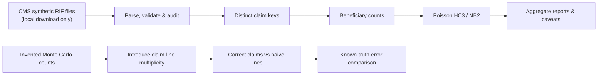
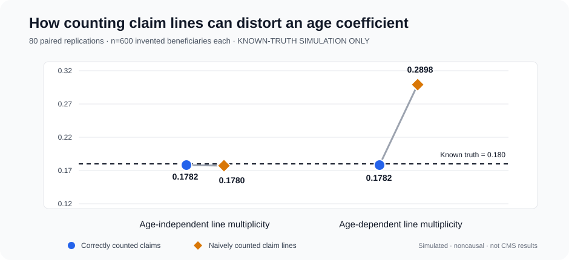

# Medicare Claims Integrity Lab
### Python · Health Economics · Claims-Data Engineering · Monte Carlo Validation

[](https://github.com/muhammad-siddique-research/medicare-claims-python-research/actions/workflows/ci.yml)


**Research portfolio:** [Study protocol](docs/RESEARCH_STUDY.md) · [Advanced Econometrics](docs/ECONOMETRIC_RESEARCH_NOTE.md) · [Simulation Findings](docs/SIMULATION_RESULTS.md) · [CMS Variable Mapping](docs/DATA_DICTIONARY.md) · [Portfolio Brief](docs/PORTFOLIO_BRIEF.md)

> **Scope and provenance.** This project uses the *official CMS synthetic Medicare claims schema* as its research-engineering target. The current demonstrated results are from **separately invented toy/simulation data**, not an executed analysis of the official CMS files. No real patients, claims-based causal effects, or nationally representative estimates are claimed. The complete CMS-supplied synthetic archive still needs local download and validation.
## Research at a glance

> **Central question:** When multiple billable lines belong to one healthcare claim, how much can a **line-versus-claim counting error** distort estimated utilization and an age-related count-model coefficient?

**Research theme:** *From raw claims to defensible inference: claim-granularity auditing and a reproducible measurement-error stress test.* This is a Python-first **computational research portfolio**, not a published scientific discovery. The novel element *within this repository* is a fully scripted falsification-style experiment: correctly counted synthetic claims are compared with naively counted claim lines under uniform versus age-dependent line multiplicity.

| Component | Scholarly value | Verified scope |
|---|---|---|
| **Claims architecture** | Claim-line deduplication, beneficiary-level linkage, transparent exclusions | Tested on invented toy fixture |
| **Computational Econometrics** | Poisson HC3, NB2 when estimable, overdispersion diagnostics | Descriptive synthetic models only |
| **Monte Carlo stress test** | Paired scenarios with known true slope and explicit measurement-error mechanism | Fully invented data; runnable Python module |
| **Research protocol** | Hypotheses, identification limits, falsification, sensitivity designs, reproducibility | [Read the scholarly research study](docs/RESEARCH_STUDY.md) |
| **Expanded inference** | HC3 confidence intervals, seeded beneficiary bootstrap, NB2 and AIC checks, observed versus fitted zeros | [Econometric research note](docs/ECONOMETRIC_RESEARCH_NOTE.md) |
| **Scientific integrity** | No invented patient claims presented as CMS findings; official CMS files not bundled | Official CMS run pending |

### What a Health Economics researcher can inspect

**Claims-data integrity:** Why counting claim lines as unique claims can corrupt descriptive outcomes, how `BENE_ID` and `CLM_ID` are linked, and why incomplete FFS coverage must not be interpreted as zero utilization.

**Transparent Econometrics:** Conditional mean assumptions, HC3 uncertainty, NB2 sensitivity, model adequacy, bootstrap intervals, and interpretations that explicitly distinguish *count ratios* from exposure-adjusted incidence rates.

**Evidence-based engineering:** Fully executable Python code, automated tests, model diagnostics, independent simulation scenarios, and reproducible figure-generating commands.

**Current empirical status:** Claims ingestion and diagnostics are tested on an invented fixture. Official CMS synthetic claims processing remains to be validated before any empirical finding is reported.

### Research workflow



### Independently reproducible simulation

```bash
python -m medicare_claims.stress_test --n-beneficiaries 600 --replications 80 --seed 20261020 --output-dir reports/stress_test
```

The experiment writes a figure, per-replication output, scenario summary, and provenance metadata. Its findings concern the **specified artificial data-generating process**, not actual Medicare beneficiaries. [Full methods, equations, hypotheses and literature](docs/RESEARCH_STUDY.md).

### Illustrated result: one counting mistake, two distinct effects



A paired Monte Carlo example using **invented data only** (80 replications, 600 invented beneficiaries per replication, known age coefficient 0.180) produced:

| Counting approach | Uniform line multiplicity | Age-dependent line multiplicity |
|---|---:|---:|
| Correct claim-level slope | **0.1782** | **0.1782** |
| Naive claim-line slope | 0.1780 | **0.2898** |
| Mean naive lines per correct claim | 1.1395 | 1.3567 |

These are **not official CMS analyses** or estimates of real bias. The scenario demonstrates how covariate-dependent line counts can alter an apparent association. See the [simulation results, assumptions, and reproducible command](docs/SIMULATION_RESULTS.md).

### Primary methodological hypothesis

**Age-correlated claim-line multiplicity can distort an estimated age–utilization coefficient if analysts mistake lines for unique claims.** An age-independent multiplicity scenario serves as a falsification comparator. The project is designed to *test* this mechanism; it does not assert that this mechanism has been observed in Medicare records. Previous literature on administrative-data selection bias and reporting motivates the research question but does **not** prove global novelty. See the [research background](docs/RESEARCH_STUDY.md#1-motivation-and-defensible-research-gap).

**Research engineering demonstration:** construction and validation of beneficiary-level utilization data from **CMS Synthetic Medicare Enrollment, Fee-for-Service Claims, and Prescription Drug Event RIF files**. This project prioritizes documented Python pipelines, correct claim granularity, reproducible econometric methods and quality assurance. It is designed as a skills demonstration for collaborative applied-economics / health-economics research.

> **Scientific integrity:** The CMS data are **synthetic, not real patient records**. They do not support population prevalence estimates, clinical recommendations, Medicare policy-effect estimates, or causal conclusions. All findings generated here are illustrative. The included **toy fixture is separately invented for automated testing** and must not be represented as official CMS data.

## Research engineering contributions

- **Source-aware ingestion:** preserves identifiers and medical codes as strings, reads CMS 2023 **pipe (`|`) separated** files and operates on 100,000-row chunks.
- **Correct unit of analysis:** differentiates claim line items from **unique claims** using `(BENE_ID, CLM_ID)` within a service type. Claim payments are not multiplied by claim lines.
- **Data quality assurance:** flags malformed service dates, out-of-year claims, missing keys, duplicate line items and contradictory claim-level payment values.
- **Beneficiary-level linkage:** constructs one row per synthetic beneficiary in a selected annual file, joins distinct inpatient/outpatient claim counts, and tracks unmatched records.
- **Methods:** descriptive age-group utilization profiles, **Poisson GLM with HC3 robust standard errors**, negative binomial NB2 when estimable, overdispersion checks, and caveats about selection/exposure.
- **Reproducibility:** modular Python package, pytest tests, versioned dependency constraints, command-line interface, Make targets and GitHub Actions checks.

### Quick start (Windows PowerShell)

Requires Python 3.10+.

```powershell
python -m venv .venv
.\.venv\Scripts\Activate.ps1
python -m pip install -e ".[dev]"
python -m medicare_claims.cli make-fixture --dest data/toy
python -m medicare_claims.cli run --data-dir data/toy --year 2022 --output-dir reports/toy
pytest -q
```

**The above tests use an invented 100-beneficiary fixture, not CMS-supplied files.** It is intended to validate code on any machine before the CMS data are downloaded.

On Linux/macOS replace PowerShell activation with `source .venv/bin/activate`. On Windows, execution-policy restrictions may require using `.venv\Scripts\python.exe` directly.

### Run with actual CMS-supplied *synthetic* files

1. Go to the [official CMS synthetic Medicare RIF collection](https://data.cms.gov/collection/synthetic-medicare-enrollment-fee-for-service-claims-and-prescription-drug-event).
2. Download the CMS **2023-era Synthetic Medicare Enrollment, Fee-for-Service Claims, and Prescription Drug Event Data** ZIP, and extract it under `data/raw/`.
3. Verify that the extracted folder includes at least `beneficiary_2022.csv`, `outpatient.csv`, and `inpatient.csv`. Keep the original **pipe** delimiter. Do not copy in files from a different SynPUF generation or release.
4. Execute:

```bash
python -m medicare_claims.cli run --data-dir data/raw --year 2022 --output-dir reports/cms_2022
```

Alternatively use `medicare-research run --data-dir data/raw --year 2022 --output-dir reports/cms_2022` after installation.

**CMS ZIP files are deliberately not included in this GitHub repo.** The code must be executed against the original official synthetic CSVs after local download. This release has *not been run here against the full CMS ZIP*; the included unit/integration tests validate the parsing and methods on a separate explicitly marked toy fixture. Release-specific schema differences may require adaptation and further validation.

### Project layout

```text
src/medicare_claims/
  io.py       source discovery, string-preserving parsing, date normalization
  build.py    cohort construction, distinct claim counting, QA
  models.py   robust Poisson, NB2, overdispersion
  report.py   aggregate summaries and charts
  toy.py      invented local fixture (NOT CMS data)
  cli.py      reproducible command line
  stress_test.py  invented Monte Carlo measurement-error experiment
  __init__.py
.github/workflows/ci.yml  automated tests and toy end-to-end pipeline
tests/                    unit and integration tests
docs/                     methods, variable mapping, ethics/limitations
data/raw/                 local official CMS files (ignored by Git)
reports/                  generated aggregate outputs (ignored by Git)
```

### Reproducible example outputs

Run the CLI on the labeled toy fixture to regenerate illustrative output in `reports/toy/`. Results are **not** official CMS estimates.

### Outputs

The `reports/<run>/` directory is populated with:

| Artifact | Interpretation |
|---|---|
| `data_quality.json` | Counts of input rows, distinct claims, duplicate lines, exclusions and conflicting amounts |
| `aggregate_descriptives.csv` | **Aggregate-only** age-band means and counts; no IDs |
| `count_model_coefficients.csv` | Coefficients, robust SE (Poisson), exponentiated age associations, AIC |
| `model_diagnostics.json` | Sample size, dispersion diagnostic and important limitations |
| `outpatient_by_age.png` | Mean outpatient claims by age band (synthetic only) |
| `RUN_SUMMARY.md` | Shareable plain-language documentation |
| `advanced_econometric_diagnostics.csv` | Both services: age coefficients, HC3 intervals, bootstrap intervals, AIC, dispersion and zeros |
| `age_associations_forest.png` | Descriptive age count ratios with 95% HC3 Wald intervals |
| `calibration_{inpatient,outpatient}.png` | Observed-versus-fitted mean counts across age bands |
| `observed_vs_expected_zeros.png` | Screening check for possible count-model misspecification |
| `advanced_econometric_provenance.json` | Seed, bootstrap design, limitations and model scope |

The code does not write joined, patient/beneficiary-level analytic tables to disk. This is intentional: while **CMS synthetic records are not PHI**, safe defaults encourage good handling of future restricted projects.

### Methodological safeguards

**Study unit:** synthetic beneficiary and observed annual claim start date. Denominator: beneficiaries present in the selected `beneficiary_YYYY.csv` file and aged 65+. This is **not** automatically a full-year Medicare fee-for-service exposure cohort. A zero synthetic claim is *not* evidence of zero actual utilization; selection, HMO/Medicare Advantage status and enrolled months require additional eligibility-specific logic. No causal treatment effect is identified.

**Distinct claims:** a service file may include multiple rows for one claim. Collapse to `(BENE_ID, CLM_ID)` **within each claim type**, then merge counts into the annual beneficiary file, avoiding a many-to-many inflation error. Dates are assigned to a year using `CLM_FROM_DT`; alternative year-allocation policies should be examined in a substantive project.

**Payment validation:** if `CLM_PMT_AMT` exists, use **one claim-level amount per unique claim**, never a line-level sum. Conflicting line values are recorded in QA and omitted from monetary totals; further adjudication would be necessary for a real analysis.

**Models:** compare Poisson (robust HC3 uncertainty) and NB2 models for counts, using an illustrative age-per-decade predictor. Negative binomial can fail to converge for small toy samples; it is gracefully omitted. Age is a descriptive correlate, **not** a causal effect. Exposure offsets are deliberately *not* imputed from incomplete enrollment information. See [methods](docs/METHODS.md) and the [recruiter-facing brief](docs/PORTFOLIO_BRIEF.md).

### Automated tests

```bash
python -m pip install -e ".[dev]"
ruff check src tests
pytest -q
```

The CI pipeline tests Python 3.10 and 3.12 and runs a deterministic toy end-to-end build. Test runs do not fetch official CMS data or export patient records. Each CI run also uploads **labeled, reproducible toy-data plots and aggregate reports** as GitHub Actions artifacts (14-day retention). Review the [workflow and generated artifacts](https://github.com/muhammad-siddique-research/medicare-claims-python-research/actions/workflows/ci.yml) from your signed-in account. Artifacts are not real CMS study outputs.

### Research conclusion

**Conclusion:** The reproducible Python pipeline and Monte Carlo design show *how to test* a potential claims measurement error while retaining transparent QA and model diagnostics. They do not yet establish any empirical result from official CMS synthetic RIFs, any real-patient utilization effect, or a novel causal estimator. Full-scale validation against the CMS-supplied synthetic files is the next necessary research milestone.

### Data provenance and source references

- Centers for Medicare & Medicaid Services. (2023). *Synthetic Medicare Enrollment, Fee-for-Service Claims, and Prescription Drug Event Data Public Use File: User guide.* [Official CMS user guide](https://data.cms.gov/sites/default/files/2023-05/d51e1218-68c3-4c7c-9598-0b81f22fe903/User%20Guide%20-%20CMS%20Synthetic%20RIF%20Files%20May%202023_AM508_v2.pdf).
- Centers for Medicare & Medicaid Services. (n.d.). *Synthetic Medicare Enrollment, Fee-for-Service Claims, and Prescription Drug Event Data* [Data collection]. [CMS Data](https://data.cms.gov/collection/synthetic-medicare-enrollment-fee-for-service-claims-and-prescription-drug-event).
- Benchimol, E. I., Smeeth, L., Guttmann, A., Harron, K., Moher, D., Petersen, I., Sørensen, H. T., von Elm, E., & Langan, S. M. (2015). The REporting of studies Conducted using Observational Routinely-collected health Data (RECORD) statement. *PLOS Medicine, 12*(10), e1001885. https://doi.org/10.1371/journal.pmed.1001885
- Cameron, A. C., & Trivedi, P. K. (2013). *Regression analysis of count data* (2nd ed.). Cambridge University Press. https://cameron.econ.ucdavis.edu/racd2/
- Dahlen, A., Deng, Y., & Charu, V. (2025). Evaluating the generalizability of commercial healthcare claims data. *American Journal of Epidemiology, 194*(10), 2999–3006. https://doi.org/10.1093/aje/kwaf142
- Virnig, B., & Parsons, H. (2021, March 16). *Strengths and limitations of CMS administrative data in research*. Research Data Assistance Center. https://www.resdac.org/articles/strengths-and-limitations-cms-administrative-data-research
- Synthetic Health. (n.d.). *Synthetic RIF validation examples*. [GitHub repository](https://github.com/synthetichealth/rif-analysis). **Reference only; no project source code copied.**

See the authoritative CMS guide for exact field definitions and release-specific limitations. The separate CMS 2008–2010 **DE-SynPUF** is *not the same dataset* and should not be mixed with this 2023 RIF pipeline.

### Responsible use and research ethics

Do not add actual Medicare claims or patient-level files, screenshots containing sensitive data, restricted clinical datasets, access tokens, or PHI to the repository. The `.gitignore` is a safeguard but cannot replace a review of commits before publishing. Avoid claiming experience with restricted Medicare claims; this work establishes proficiency with **synthetic claims-compatible data construction** only.

**Scope of this release:** code + tests + toy validation. An official-CMS-data run and results should be created only after downloading/verifying the official files, checking data dictionaries and assessing observed enrollment completeness.

### Suggested resume entry (only after you run the actual CMS data)

> **Synthetic Medicare Claims Analytics (Python)** — Developed and tested a reproducible pipeline for CMS synthetic Medicare RIF enrollment and claims records, incorporating claim-level deduplication, beneficiary linkage, QA auditing, Poisson/negative-binomial analysis, and CI-based tests. *Synthetic data methods demonstration; no inference about real Medicare patients.*

### License

Project code: MIT. CMS source datasets and upstream documentation follow their own source notices; no CMS data have been bundled with this repository.